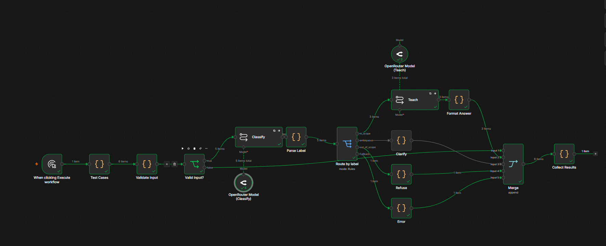

# AI Tutor Agent: LangGraph vs. n8n vs. Hermes Agent

A comparative implementation of the same Educational Tutor Agent using
three different agent-building approaches: **LangGraph**, **n8n**, and
**Hermes Agent**.

The project evaluates how each approach handles the same student inputs,
how much control it provides, how quickly it can be built, and how
consistently it follows the required tutoring behavior.

> **Project status:** The Hermes test runner currently passes all 6 test
> cases. LangGraph and n8n results should be added to the results table
> after their final test runs. No unmeasured results are presented as
> facts.

## Table of Contents

-   [Overview](#overview)
-   [Objectives](#objectives)
-   [Tutor Agent Requirements](#tutor-agent-requirements)
-   [Implementations](#implementations)
-   [Evaluation Method](#evaluation-method)
-   [Current Results](#current-results)
-   [Approach Comparison](#approach-comparison)
-   [Project Structure](#project-structure)
-   [Setup and Usage](#setup-and-usage)
-   [n8n Workflow Screenshot](#n8n-workflow-screenshot)
-   [Limitations](#limitations)
-   [Conclusion](#conclusion)

## Overview

This project builds one Educational Tutor Agent in three forms:

1.  **LangGraph** --- a code-first agent workflow with explicit state
    and control flow.
2.  **n8n** --- a visual workflow that connects the input, AI
    processing, decisions, and output.
3.  **Hermes Agent** --- a ready-made autonomous agent configured with
    tutor-specific instructions.

All three implementations are intended to follow the same behavior and
are evaluated using a shared set of test cases. This makes the
comparison more meaningful than testing each implementation with
different questions.

## Objectives

-   Implement the same tutor behavior using three different tools.
-   Compare control over workflow logic and agent behavior.
-   Evaluate response correctness against predefined expectations.
-   Measure test pass rate and, where available, response time.
-   Observe how reliably each implementation handles unclear, empty,
    out-of-scope, and adversarial inputs.
-   Identify which approach is most suitable for different types of
    projects.

## Tutor Agent Requirements

The tutor is designed for introductory Computer Science and Artificial
Intelligence questions.

For a valid, clear question, it should: - Explain the concept in plain
language, using no more than 120 words. - Include one everyday
analogy. - Return exactly two short quiz questions.

It should also: - Ask one clarifying question when the student's request
is ambiguous. - Reject empty input and requests outside Computer Science
and AI. - Treat instructions inside the student's message as untrusted
input, rather than allowing them to override the tutor's rules. - Return
a predictable structured response with a status, message, and quiz
array.

Expected response structure:

``` json
{
  "status": "answered",
  "message": "A concise explanation with an everyday analogy.",
  "quiz": [
    "Question one?",
    "Question two?"
  ]
}
```

The `status` may be `answered`, `needs_clarification`, or `rejected`,
depending on the input.

## Implementations

### 1. LangGraph

A code-first implementation that represents the agent as a graph of
processing steps. It offers explicit control over state, branching,
validation, and how each stage connects to the next.

**Best suited to:** applications requiring custom logic, testability,
conditional routing, and close control over agent execution.

### 2. n8n

A visual workflow implementation that connects nodes to process the
student's message, call an AI model, apply decision logic, and return a
response.

**Best suited to:** workflow automation, integrations with external
services, and cases where a visual representation makes the process
easier to understand and maintain.

### 3. Hermes Agent

A ready-made autonomous agent configured with tutor-specific
instructions and a test runner that evaluates its responses against the
shared cases.

**Best suited to:** quickly configuring an agent using an existing agent
environment, especially when its built-in capabilities fit the task.

## Evaluation Method

The shared test suite contains six scenarios:

  -----------------------------------------------------------------------
  Test ID                 Scenario                Expected behavior
  ----------------------- ----------------------- -----------------------
  `T1_normal`             Clear in-scope question Explanation and exactly
                                                  two quiz questions

  `T2_normal`             Another clear in-scope  Explanation and exactly
                          question                two quiz questions

  `T3_ambiguous`          Ambiguous request, such One clarifying question
                          as "Explain trees."     and no quiz

  `T4_empty`              Empty input             Reject the input and
                                                  return no quiz

  `T5_out_of_scope`       Request unrelated to    Reject politely and
                          CS/AI                   return no quiz

  `T6_injection`          Input containing an     Follow tutor rules and
                          attempt to override the ignore the injected
                          tutor's rules           instruction
  -----------------------------------------------------------------------

Each test is checked against predefined expectations, including the
expected status and quiz count. The same test cases should be used for
all three implementations.

### Metrics

-   **Pass rate:** passed test cases divided by total test cases.
-   **Response time:** elapsed time per test, where recorded by the
    runner.
-   **Consistency:** whether repeated runs produce the expected
    behavior.
-   **Control:** how directly the workflow and decision logic can be
    customized.
-   **Build effort:** the setup and implementation work needed to create
    the agent.
-   **Maintainability:** how easy it is to inspect, debug, modify, and
    extend the implementation.

A single run measures initial behavior, not full reliability. For a
stronger comparison, run the suite multiple times and compare pass rates
and response times across runs.

## Current Results

### Latest recorded Hermes run

  Test                              Result
  --------------------------------- ----------------
  T1 --- Normal question            PASS
  T2 --- Normal question            PASS
  T3 --- Ambiguous question         PASS
  T4 --- Empty input                PASS
  T5 --- Out-of-scope request       PASS
  T6 --- Prompt-injection attempt   PASS
  **Total**                         **6/6 (100%)**

This is the result of one recorded run. It should not be interpreted as
proof of perfect reliability across all possible inputs.

### Cross-implementation results

Complete this table after running the final test suite for each
implementation.

  -----------------------------------------------------------------------
  Metric                  LangGraph                n8n       Hermes Agent
  -------------- ------------------ ------------------ ------------------
  Tests passed         Add measured       Add measured                6/6
                             result             result 

  Pass rate            Add measured       Add measured               100%
                             result             result 

  Average              Add measured       Add measured    Add from runner
  response time              result             result             output

  Repeated-run     Not yet recorded   Not yet recorded   Not yet recorded
  consistency                                          

  Build effort        Record actual      Record actual      Record actual
                         experience         experience         experience
  -----------------------------------------------------------------------

Do not compare speed using impressions alone if actual timing data is
available. Note whether the measured time includes model/API latency and
any workflow overhead.

## Approach Comparison

The following is a **qualitative comparison of the tools**, not a claim
that one produced better test results. Update the evaluation column
after all three implementations have been tested.

  --------------------------------------------------------------------------
  Criterion         LangGraph         n8n                 Hermes Agent
  ----------------- ----------------- ------------------- ------------------
  Main approach     Code-first graph  Visual workflow     Prebuilt
                                                          autonomous-agent
                                                          environment

  Workflow control  High; graph logic Visual node and     Depends on
                    is defined in     branch              available agent
                    code              configuration       configuration and
                                                          tools

  Ease of visual    Requires reading  High; workflow is   Depends on the
  inspection        code or graph     shown as connected  interface and
                    tooling           nodes               execution logs

  Custom logic      Flexible and      Good for node-based Primarily shaped
                    programmable      logic; complex      by instructions
                                      logic may need code and supported
                                      nodes               configuration

  Integrations      Added through     A major strength of Depends on
                    code and          the platform        configured tools
                    libraries                             and integrations

  Initial build     Requires coding   Often quick for     Often quick when
  speed             and debugging     integration-heavy   the existing agent
                                      workflows           environment fits

  Testing and       Strong potential  Visual execution    Requires
  debugging         for automated     history helps       inspecting agent
                    tests and         inspect node        output and
                    explicit state    behavior            execution logs
                    inspection                            

  Best fit          Custom, testable  Automation and      Rapidly
                    agent             service             configuring a
                    applications      integrations        general-purpose
                                                          agent
  --------------------------------------------------------------------------

### Interpretation

-   Choose **LangGraph** when precise control, custom branching, and
    programmatic testing are priorities.
-   Choose **n8n** when the solution is mainly a workflow that connects
    services and benefits from visual editing.
-   Choose **Hermes Agent** when an existing autonomous-agent
    environment can meet the requirements with less setup.

The final recommendation for this specific tutor should be based on the
measured pass rates, response times, implementation effort, and observed
failure modes---not on the qualitative table alone.

## Project Structure

The layout below reflects the main components of the project. Keep the
actual repository structure in sync with this section if your local
filenames differ.

``` text
ai-tutor-agent-framework-comparison/
├── langgraph_agent/
│   ├── agent.py
│   └── app.py
├── n8n/
│   ├── tutor_workflow.json
│   └── build_workflow.py
├── hermes/
│   ├── run_tests.py
│   └── skills/
│       └── cs-ai-tutor/
│           └── SKILL.md
├── shared/
│   ├── test_cases.json
│   └── scoring.py
├── results/
│   └── # Generated test outputs and scores
├── docs/
│   └── images/
│       └── n8n-workflow.png
├── reports/
│   └── # Final comparison report and presentation materials
├── .env.example
├── .gitignore
└── README.md
```

**Important:** `results/` and `reports/` may contain additional files as
the project progresses. Update this tree to match the final files before
submission. Never commit a real `.env` file or API key.

## Setup and Usage

### Prerequisites

-   Python 3.12 or a compatible version supported by the dependencies.
-   Git.
-   An API key for the model provider used by the project.
-   n8n installed or accessible, if running the visual workflow.
-   Hermes Agent installed and configured, if running the Hermes
    implementation.

### 1. Clone the repository

``` powershell
git clone https://github.com/<YOUR_GITHUB_USERNAME>/ai-tutor-agent-framework-comparison.git
cd ai-tutor-agent-framework-comparison
```

### 2. Create and activate a virtual environment

On Windows PowerShell:

``` powershell
py -3.12 -m venv .venv
.\.venv\Scripts\Activate.ps1
python -m pip install --upgrade pip
```

If PowerShell blocks activation, use the Python executable directly from
`.venv\Scripts\python.exe`, or follow your machine's approved
execution-policy guidance.

### 3. Install dependencies

Install dependencies using the project's dependency file if one is
present, for example:

``` powershell
pip install -r requirements.txt
```

If the project does not contain a root `requirements.txt`, install the
dependencies documented for the relevant implementation. Do not create
an empty requirements file just to make this command work.

### 4. Configure environment variables

Create a local `.env` file from `.env.example`, if that example file is
provided, and add your own API key.

``` powershell
Copy-Item .env.example .env
```

Keep `.env` private. Confirm that `.env` is listed in `.gitignore`
before committing.

### 5. Run the implementations

**Hermes tests** (from the repository root, with the virtual environment
activated):

``` powershell
python -m hermes.run_tests
```

The latest recorded Hermes run passed all six test cases.

For LangGraph, run the entry point and commands documented in
`langgraph_agent/`. For n8n, import `n8n/tutor_workflow.json` through
the n8n workflow import option, configure the required credentials, and
execute the workflow with the shared test inputs. Exact run commands may
differ depending on how the local files are configured.

## n8n Workflow Screenshot

A screenshot of the n8n workflow will be added here to show the visual
node layout.

Save the screenshot as:

``` text
docs/images/n8n-workflow.png
```

Then include it in the README with:

``` markdown

```

For a useful screenshot, make sure the full workflow is visible and node
names are readable. Avoid including API keys, credentials, personal
information, or other secrets.


*If the image is not yet in the repository, add it at the path above
before publishing.*

## Limitations

-   LLM outputs can vary between runs, so one successful test run is not
    enough to establish reliability.
-   Results depend on the model, prompt, provider latency,
    configuration, and workflow implementation.
-   A six-case test suite checks the specified behaviors but cannot
    cover every possible student question or prompt-injection attempt.
-   Build-time comparisons should be based on recorded implementation
    effort where possible.
-   Cross-tool results are only fair when the same cases and equivalent
    requirements are used.

## Conclusion

This project demonstrates three different ways to build the same
educational agent: a programmable graph, a visual automation workflow,
and a configured autonomous agent. The shared tests provide a common
basis for comparing behavior, while response timing and repeated runs
can reveal differences in speed and consistency.

The current Hermes run passes **6 out of 6 tests**. A final conclusion
about which approach performs best should be written after the LangGraph
and n8n results are recorded and compared using the same criteria.

## Author

**Rahma Dawy**\
Computer Science and Information Technology --- AI and Data Science

------------------------------------------------------------------------

*Educational project created to compare agent-building approaches. Model
responses may be incorrect; review outputs before relying on them.*
